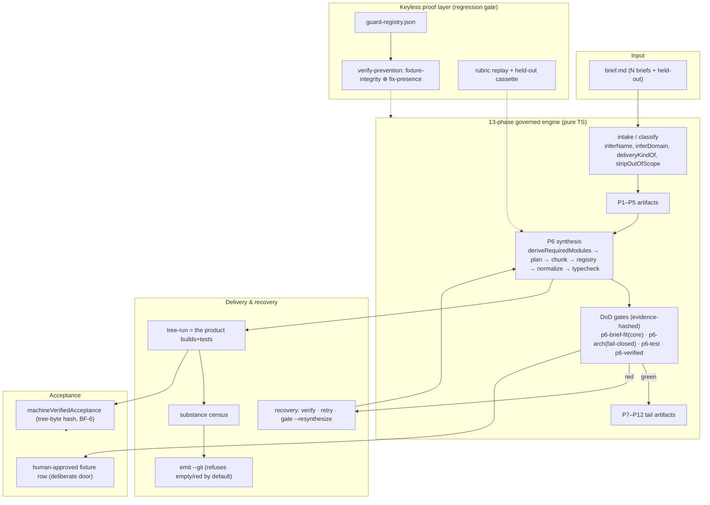
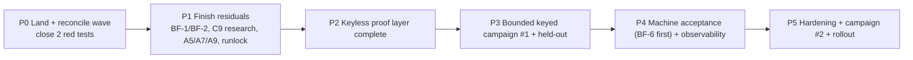
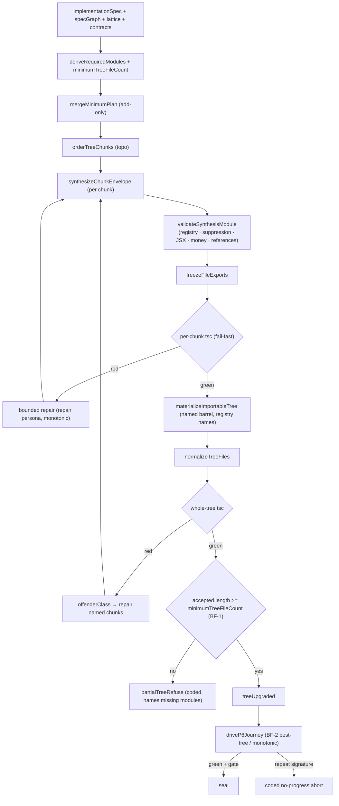
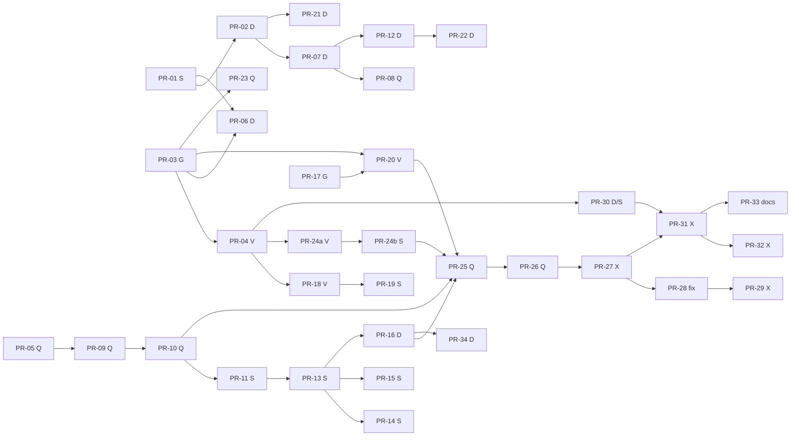

# RapidTool as a Genuinely Working Autonomous AI‑Agent Software Factory

**Document status:** Draft (revision 2 — incorporates four independent reviews: truth/correctness, completeness, logic/feasibility, and BUILD_FORENSICS)
**Author:** _(placeholder — owner/architect)_
**Date:** 2026‑10‑05
**Repository:** `C:\Users\mnril\Desktop\RapidTool Main` (HEAD `886f155` + one uncommitted six‑lane wave)
**Artifact root under study:** `C:\Users\mnril\Desktop\testruns\`
**Related design lanes:** `_research/{TASKLIST,LANES,R1_pipeline,R2_bestpractices,SYNTHSPEC,FINDINGS,PREVENTION,BUILD_FORENSICS}.md`

> **Claim scope (corrected).** This program delivers, on its own authority, a **machine‑verifiable acceptance reading** and a factory that **produces verified, delivered apps within budget, with failures expressed honestly**. Whether that satisfies the word *"autonomous"* is an **owner decision** (§4.8 Open Question 1), because the repo's `autonomousSoftwareFactory` flag is human‑stamped by design. The plan does not delete that door and does not claim the flag flips without the owner's recorded decision.

---

## 1. Overview

RapidTool is a real, gated TypeScript product: a TanStack Start console plus a deterministic 13‑phase governed pipeline plus a **39‑verb** headless CLI. Its governance and honesty machinery is genuinely excellent — across seven keyed DeepSeek runs it never faked green, coded every failure, and re‑executed emitted trees to verify them. Its **production half (P6 code synthesis) is the broken stage**: **0 of 7 emitted trees is the app in its brief** (independent exam: `_exam/E1_build.md` = 0 working / 8 partial / 5 broken of 13 trees; `_exam/E2_quality.md` = mean ≤ 4/10, matches‑brief 0–2; `_exam/E3/E3_audit.md` = claim audit; `_research/BUILD_FORENSICS.md` = per‑build postmortem). The tool truthfully reported that failure — which is why this is a "finish and improve the existing machine" design, not a greenfield rewrite.

This revision **absorbs four reviews** and corrects the draft's central factual premise: **Lane C is not "still running" — it is done.** C1 (brief‑fit core‑noun calibration), C2 (classifier + `stripOutOfScope`), C4 (packet sections), C5 (`store.approve` refuses under `enforceDod`), C6 (`engine.deepenResearch` `RT_E_RESEARCH_UNAVAILABLE`), C8 (`p6‑arch` fail‑closed) and the defect→repair learning loop are **present in the working tree** (`sandbox.ts:447` `briefNounCore`; `dod.ts:571` `core missing`; `dod.ts:865` `p6.synthesis.attempt` fail‑closed; `knowledge.ts:1300` `defectClassOf`; `engine.ts:3748` empty‑corpus throw; `packet.ts:1260` `protectedBlocks`; `store.ts:2480` C5 refusal). The genuinely unlanded C seam is **C9 intent‑first research** (`engine.ts` `researchQueryText` still emits domain‑nouns‑first). The plan is therefore **shorter**: land/reconcile the wave, close two red tests, finish a small residual set, prove keyless, run a bounded keyed campaign, and settle the autonomy contract.

The design's core invariant is inherited verbatim: **produce more, refuse no less.** No gate is lowered, no skip is promoted to a pass, no `@ts-nocheck`, no retry‑until‑green.

---

## 2. Background & Motivation

### 2.1 What RapidTool is today

- **Engine:** pure TypeScript modules in `src/lib/` driven by `headless.ts` and `engine.ts`; the browser and CLI are thin surfaces.
- **Governance:** every approval carries a seat (`autopilot` vs an out‑of‑band‑token human seat); every phase transition needs evidence; every refusal is a coded `RT_E_*` from `errors.ts`.
- **Synthesis:** P6 asks a model for module code in **signature‑bound chunks**, then compile‑checks and runs each job module's own oracle (`codegen.server.ts`, `compile-check.server.ts`).
- **Delivery:** `scripts/factory-watch.mjs` (`npm run factory`) drains a brief through `create → unattended → emit --run (verify) → emit --git (deliver)`.

### 2.2 The measured failure (the evidence base)

A genuine 7‑project keyed acceptance run was executed into `C:\Users\mnril\Desktop\testruns\<slug>\` — **1,352,989 tokens / 212 calls / ~$0.82** (spend is derived; `doctor` reports `estimatedCostUsd:null`), with v2 re‑runs after one classifier fix. Results (re‑derived in `_exam/` and `_research/BUILD_FORENSICS.md`):

| Fact | Evidence (corrected anchors) |
|---|---|
| 0 working / 8 partial / 5 broken emitted trees | `_exam/E1_build.md` result table |
| **8 of 13 trees** have their own `tsc --noEmit` exit 0 (5 fail) | `_exam/E1_build.md` table (the draft's "7/13" was wrong) |
| Mean quality ≤ 4/10; matches‑brief 0–2/10 | `_exam/E2_quality.md` score table |
| **6 of 13 emitted trees (8 emit envelopes)** committed `substance:"empty"` with `ok:true`, `git.committed:true`; among the 7 v1 projects, **4** did | `_report/BUGLEDGER.md` BL‑004; `_meta/STAGE_DEBUG.md` Stage 7; six `emit*.json` + six real `git log` commits |
| 5 red‑banner commits advertised as delivered | BUILD_FORENSICS §3.4 |
| Barrel duplicate export `TS2308` + load‑time `SyntaxError` | `_exam/E1_build.md:28` |
| Generated store `TS2448` use‑before‑declaration | `_exam/E1_build.md:30` |
| Repair exhausted 3/3 cycles and *worsened* the tree | `_report/BUGLEDGER.md` BL‑006; `repair.json` |
| No recovery from a red P6 (`verify` exit‑4 `RT_E_UNKNOWN`, `retry` `RT_E_PHASE_ILLEGAL`, `gate` 0 steps) | BL‑003/BL‑007; `_meta/STAGE_DEBUG.md` Stage 8 |
| `cachedPromptTokens = 0` on all 212 keyed calls | `_research/FINDINGS.md` O‑02 |
| 4/7 v1 and 4/6 v2 stalled at the P6 DoD gate | `_research/R1_pipeline.md:13,31`; `_exam/E3/E3_audit.md:79`; `_meta/FACTORY_VERDICT.md:29`; `_meta/ANSWERS.md:41` |
| The `tested` `evidenceHash` is reused across projects | BUILD_FORENSICS §3.8 (new finding — hash over the verdict string, not the tree bytes) |

`_meta/FACTORY_VERDICT.md`: **worth using as a governed scaffold‑and‑audit harness; not yet worth using as an app factory.**

### 2.3 Why P6 is the wall (root causes, code‑grounded — REFINED by BUILD_FORENSICS)

`_research/SYNTHSPEC.md`, `_research/R1_pipeline.md`, and `_research/BUILD_FORENSICS.md` trace the seams. The draft framed root cause #1 as "file count is driven by the model's emitted `typeSignatures`, so a 2‑file tree ships." **BUILD_FORENSICS REFINES this:** the persisted plan was **multi‑chunk** (`p6.tree.plan.reconciled` shows a deterministic capability floor; flower cycle 1 logs *"tree 7/7 chunks accepted"*), so the 2‑file artifact is produced by **chunk refusal + non‑monotonic final selection** (`partialTreeRefuse` keeping the smallest partial, and `driveP6Journey` returning the last cycle). The four seams are therefore:

1. **Plan under‑production *and* non‑monotonic persistence.** The minimum file set was only a *plan floor*; a partial can still *become* the artifact, and the journey discarded the most complete tree (flower 7→2). **Both the refusal (BF‑1) and the monotonic selection (BF‑2) are co‑equal P0.**
2. **Unvalidated assembly.** `validateSynthesisModule` is per‑chunk and sees only *earlier* chunks; the ESM barrel `materializeImportableTree` writes was never validated → `TS2308`/`TS2440` and a load‑time `SyntaxError`. The frozen registry (landed) is the fix; the **detector must read the materialized surface, not the envelope claim** (BF‑3).
3. **Non‑monotonic repair.** The journey accepted a synthesized project whenever the tree‑run was green; `repairTreeDir` wrote repaired rows in place before re‑running, so a worsening cycle left worse bytes (bfo burned 273,405 tok / 40 calls and worsened the tree).
4. **Over‑delivery of hollow output.** `--git` gated only on a *red* judge leg; `substance:"empty"` was not a leg (6 empty‑substance commits + 5 red‑banner commits). **Landed** (`RT_E_SUBSTANCE_EMPTY`).

### 2.4 What already landed in the current uncommitted wave (six lanes A–D + P‑A/P‑B)

The design builds on these, not re‑plans them. **Corrected per‑lane file lists** (from `git status --short`; files the draft wrongly attributed are marked):

- **Lane A/S — P6 synthesis** (`codegen.server.ts` + `.test.ts`, `scaffold.ts` + `.test.ts`): brief‑driven minimum file set (`deriveRequiredModules` `:2341`, `minimumTreeFileCount` `:2432`), frozen export registry + named barrel (`bindingLinesForCollision` `:2836`, `materializedExportNames` `:2913`, `freezeFileExports` `:2940`), `suppressionPragmaHit` `:2967`/`jsxHits` `:2988`, tree normalizer (`normalizeTreeFiles` `:3190`), `offenderClass` `:4395`, brief‑driven UI shell, blocking/monotonic chunk repair. **Residual:** A5 (money), A7 (repair parity), A9 (best‑of‑N/adaptive sizing), A10/A11, and the **BF‑1 hard refusal** + **BF‑2 exported comparator**.
- **Lane B/D — delivery/recovery** (`scripts/rapidtool-cli.mjs`, `cli-exit-taxonomy.test.mjs`, `headless.ts` + `.test.ts`, `compile-check.server.ts` + `.test.ts`): substance gate (`RT_E_SUBSTANCE_EMPTY` `:2320`, `--allow-empty` `:2299`), private best‑tree helpers (`bestTreeMetricOf`/`isBetterTree`/`keepBestTree` `headless.ts:3202–3229`), recovery doors, hardened behavioural‑spec guard. **Note:** `git.server.ts` and `node-runner.server.ts` are **unmodified** (the draft wrongly listed them).
- **Lane C/G — gates/logic/learning** (`dod.ts`, `engine.ts`, `knowledge.ts`, `sandbox.ts`, `packet.ts`, `store.ts`, `errors.ts`, + tests): **DONE** — C1 core‑noun brief‑fit (`sandbox.briefNounCore`/`briefFitCoreNeed`/`briefFitCoverage`/`briefFitSubstancePasses`; `dod.ts:571` emits `core missing (…)`), C2 classifier + `stripOutOfScope` (`engine.ts:244`), C4 packet `protectedBlocks` (`packet.ts:1260`), C5 `store.approve` refuses under `enforceDod` (`store.ts:2480`, `RT_E_GATE_PENDING`), C6 `engine.deepenResearch` empty‑corpus throw (`engine.ts:3748`, `RT_E_RESEARCH_UNAVAILABLE`), C8 `p6‑arch` fail‑closed (`dod.ts:865`), C16 `inferName` (`engine.ts:424`), and the defect→repair learning loop (`knowledge.ts:1300` `defectClassOf`, `:1321` `DEFECT_REPAIR_CLASS`, `defectRepairLesson`, `selectDefectRepairLessons`, `applyLessonDemotion`, `:1985` `reproducedCount`). **The only genuinely unlanded C seam is C9 intent‑first research** (`engine.ts` `researchQueryText`).
- **Lane D/V — personas/verification** (`verify.server.ts` + `.test.ts`, `verify.ts`, `crew.server.ts` + `.test.ts`, `crew.ts`, `prompt-engine.ts` is **clean/unmodified** — corrected, `llm/providers/deepseek.ts` + `deepseek-taxonomy.test.ts`, `policy.ts` is **clean/unmodified** — corrected, `scripts/verify-mint-writers.test.mjs`): personas, legal refusal channel, dedicated repair prompt, `VerifyOutcome.code` (`RT_E_RUNNER_FAILED`), single‑writer `tested` guard, `finish_reason` taxonomy, cache‑aware prompt ordering.
- **P‑A replay harness** (`scripts/prevention/**`): `node scripts/prevention/verify-prevention.mjs --all --selftest` → `{"ok":false,"guards":13,"historical":12,"fired":["C-01","C-02","C-03","C-13","C-09","C-11","C-06","C-05","C-12","C-14","C-16","C-18"],"missed":["C-04"],"skipped":0,"registry":"present","controlMissed":[]}` (re‑run for this revision). **Only C‑04 is missed.** **Caution (logic review):** `fired` is computed from the *historical broken artifacts*, not from whether the fixer seam landed — see §4.6.
- **P‑B invariant guards** (`scripts/guards/**`): a 13‑entry `guard-registry.json`. Four entries are `status:"pending"` (C‑04, C‑12, C‑14, C‑18) — **stale metadata**: C‑12/C‑14/C‑18 already report `fired` and their fixers (C2/C8/C4) landed; only **C‑04** is genuinely red (`repair-monotonic.test.mjs` 1 pass / 1 fail: *"C-04 [PENDING lane B / B2] the monotonic comparator must reject a non-improving repair"*).

### 2.5 The two remaining red tests (corrected — neither is a concurrency artifact)

1. **`headless.test.ts` `W50 · 336‑2`** — a **deterministic regression**, not a mid‑edit artifact. `node --experimental-strip-types --test src/lib/headless.test.ts` → **pass 171 / fail 1**; the failing assertion (`:4718`) is *"the real mint + real gate converge over this fixture"* → actual `failed` vs expected `converged`, with the gate reason *"keyed tree synthesis ran (2 file(s)) … core missing (1/2): operator"*. It is caused by the wave's own **C1 core‑noun bar**. **Owner: Lane B/D.** The exact fixture fix is known: null the fixture's `p.lattice`/`p.contracts`, **or** name the core nouns in the fixture source (`deliverCoreWorkflow` currently hits only 1 of 2 core nouns). No source‑code change is needed.
2. **`repair-monotonic.test.mjs` C‑04** — needs Lane B/D to export a comparator, **and the guard pin adjusted to the real `BestTreeMetric` interface**. **Owners: Lane B/D + P‑B/Q.**

### 2.6 The autonomy definition problem

`doctor` reports `autonomousSoftwareFactory:false` with named `gaps[]`. The flag **requires a human‑approved fixture row by construction** (`doctor.ts:5‑9` module header; enforced by `humanFixturesFromProject` `:391` and `factoryClaim` `:671`,`:699`: `humanFixtures === true` needs `decidedBy:"human"`). W53‑340‑2 added `awaitingHumanAcceptance` (a separate reading of the *same* evidence; `doctor.ts:15‑20`), and 346‑lane‑2 added **`machineVerifiedAcceptance`** — "the SEPARATE, derived reading … an external, re‑runnable persisted verdict (the P6 tree‑run `lastTest` promotion stamp) reported under its own machine seat" (`doctor.ts:22‑26`). That is the seed of the independent acceptance path this design completes — **but BUILD_FORENSICS §3.8 shows the `tested` `evidenceHash` is currently project‑insensitive (`761559975` reused across three projects), so the machine reading cannot be treated as evidence until BF‑6 hashes the tree bytes.** The design does **not** delete the human door.

### 2.7 Pain points (owner‑visible)

- The owner's maker test is the **Coffeehouse2Home / Property Ledger** real‑estate suite; currently unachievable because the UI is a shell.
- UI is jargon‑dense; the emitted app is a placeholder or a one‑function form (`E2` 0–2/10).
- `ok:true`/`13/13`/`committed:true` were awarded to hollow artifacts; the summary signals are decorrelated from reality.

---

## 3. Goals & Non‑Goals

### 3.1 Goals

- **G1 — P6 reliability.** A keyed run over a representative brief set produces a tree that passes its own `tsc --noEmit` + `npm test`, maps every declared capability to a real file, and mounts a brief‑derived UI calling real generated exports.
- **G2 — Delivery truth.** `emit --git` never commits an `empty`‑substance or uncleared red tree without an explicit opt‑in; `factory-watch` verifies (re‑executes) before it commits and persists the verdict hash.
- **G3 — Recovery.** A red P6 has ≥1 bounded, coded re‑entry that converges or aborts honestly on a repeated failure signature.
- **G4 — Prove it keyless.** Every historical defect class is enforced by a keyless guard/replay that (a) **fires on the real persisted artifact** *and* (b) **asserts the live seam is present and wired** — the two are reported separately and both are required.
- **G5 — Bounded keyed proof.** A cost‑capped keyed acceptance campaign (with a campaign‑aggregate bound, not a per‑process cap) end‑to‑end, with persisted evidence, over the seven briefs **plus a held‑out brief**.
- **G6 — Machine‑verified acceptance.** An independent machine acceptance reading is available; the *headline autonomy claim* is contingent on the owner's recorded decision (§4.8, Open Q1).
- **G7 — Observability.** Spend, cache hits, calls/cycles, rubric score, and per‑run verdicts are recorded and alarmed, not merely printed.

### 3.2 Non‑Goals

- **No greenfield rewrite.** Keep the 13‑phase engine, the `RT_E_*` registry, the DoD gate system, and the CLI verb surface.
- **No gate weakening.** Never lower `p6-brief-fit`/`p6-arch`/`p6-test`/`p6-verified`, the forbidden‑primitive scan, the red‑tree guard, or the assertion‑gap lint.
- **No OS sandbox claim.** The bounded runner applies Node's Permission Model; it is not Docker/bwrap/AppContainer, and no network denial is claimed.
- **No provider switch that cannot fail over** unless a second family is probed and `LlmResult` carries served‑provider provenance.
- **No i18n, no remote/PR delivery, no in‑product scheduler.**
- **No hand‑editing of `emitted*/` or `build*.json`** to change a label.

---

## 4. Proposed Design

### 4.1 Target architecture



### 4.2 The critical path (shortest honest path — shortened because Lane C is done)



The single most valuable early action is **not** new code: it is committing the wave on disk, fixing the two deterministic reds, and **reworking the harness so its green signal means "the live seam is present and wired", not merely "the historical defect is still visible"** (§4.6, logic review Issue 1). Then the wall is BF‑1/BF‑2 + the small A/C9 residuals + a bounded keyed validation.

### 4.3 P6 synthesis — the fix set

#### 4.3.1 Status table (landed vs residual — corrected)

| Concern | Landed artifact | Residual to close |
|---|---|---|
| Brief‑driven minimum file set | `deriveRequiredModules`/`minimumTreeFileCount`/`mergeMinimumPlan` (`codegen.server.ts:2341`,`:2432`,`:2489`) | **BF‑1: make it a hard refusal** — `partialTreeRefuse` when `accepted.length < minimumTreeFileCount`, naming missing modules |
| Frozen export registry | `bindingLinesForCollision` `:2836`, `materializedExportNames` `:2913`, `freezeFileExports` `:2940` | **BF‑3:** registry drives prompt + validator + materializer; fix the **detector to read the materialized surface** (residual CJS escape) |
| Tree normalizer (TDZ/TS2393/import hygiene) | `normalizeTreeFiles` `:3190` | `unresolved` → bounded repair → refuse; pure‑initializer‑only hoist (SYNTHSPEC F2/F6) |
| Cross‑chunk shared‑type drift | registry carries export names | Carry prior chunks' **type** names too; refuse a later chunk that redeclares a shared entity type (SYNTHSPEC F7) |
| Unknown‑reference validator | — | `referencedIdentifiers(module)`; unknown reference → one bounded repair (R2 Row 5 / SYNTHSPEC F4, `cbReportLoadState`) |
| JSX/module contract | `suppressionPragmaHit` `:2967`, `jsxHits` `:2988` | **BF‑4:** refuse JSX in a `.ts` chunk with one JSX‑free repair, or relocate to `.tsx` in lockstep |
| Blocking/monotonic chunk repair | blocking pre‑seal typecheck + offender mapping | **BF‑2 (co‑equal P0):** export `treeVerdictScore`/`failureSignature`; monotonic selection on the **persisted** tree |
| Incremental fail‑fast | — | **A6:** per‑chunk `tsc` before paying for chunk i+1 |
| Brief‑driven UI shell | `scaffold.ts` default UI | **A4 + BF‑10 over‑scope:** entity screen set; **guarantee a browser entry per kind** (mobile v1 `kind:"library"` emitted **no `index.html`/`vite.config.ts`** → unopenable) |
| Money semantics | — | **A5/BF‑5:** `RT_E_VALIDATION · money-semantics` + one bounded repair |
| README manifest honesty | — | **A10/BF‑11:** filter `specRows` to disk; "declared, NOT emitted" sub‑table |
| Banner congruence | — | **A11** |
| Zero‑importer bridges (FINDINGS F‑04, ~39 dead files) | — | **Name it:** materialise `src/domain/*`, `src/state/store.ts`, `src/api/routes.ts` for real, **or** drop the bridge and record the path unmaterialised (do not emit an alias that reads as a module) |
| Primary best‑of‑N + adaptive sizing | — | **A9** (`synthesis-policy.ts`) |

#### 4.3.2 The synthesis data flow (target)



#### 4.3.3 The C‑04 comparator — corrected to the real interface

The draft declared `treeVerdictScore` as a 5‑element tuple and `failureSignature` as existing private helpers, and called the fix "a one‑line interface change / thin wrappers / no behavior change". **That is wrong.** The real private comparator is:

```ts
// src/lib/headless.ts:3186 (verified)
type BestTreeMetric = { ok: boolean; ts: number; files: number };
function bestTreeMetricOf(project: Project, verdict: TreeRunOutcome | null): BestTreeMetric;
function isBetterTree(a: BestTreeMetric, b: BestTreeMetric): boolean;
```

There is **no `failureSignature`** (`grep failureSignature src/lib/headless.ts` → 0), and the guard compares `score(better) > score(worse)` numerically (`repair-monotonic.test.mjs:46–48`), which a tuple cannot satisfy. The change is therefore **new logic**, not a wrapper:

```ts
// src/lib/headless.ts — EXPORTED (Lane D). New functions; documented behavior change.
export type TreeVerdictScore = { ok: boolean; ts: number; files: number };   // the real BestTreeMetric, exported
export function treeVerdictScore(outcome: TreeRunOutcome | null): number;    // scalar: lexicographic (ok, -ts, files); higher is better
export function failureSignature(cycle: {
  refusal?: string | null; treeTail?: string | null; offenderFiles: readonly string[];
}): string;                                                                   // stable hash of (coded reason ‖ offender set)
```

`treeVerdictScore` must make `isBetterTree` equivalent to `score(a) > score(b)` (a scalar projection of the lexicographic order), and `driveP6Journey` must actually **call `failureSignature` and abort** on a repeat — the guard pin (PR‑08) must assert the abort, not merely the symbols' existence.

#### 4.3.4 The A→B resume interface — corrected to the real signature

The draft's `synthesizeChunkedTree(project, spec, opts?: { resumeAccepted? })` does not exist. The real symbol (`codegen.server.ts:5576`) is **module‑private, async**, and positional:

```ts
async function synthesizeChunkedTree(
  project: Project, brief: string, specRecord: NonNullable<Project["implementationSpec"]>,
  complete: P6SynthesisDeps["complete"], treeFailure?: string, patchRepairs = false,
  gateRepair?: string, synthesisRefusal?: string, proven?: …, typecheck?: …, candidates?: …,
): Promise<Project>;
```

A repository‑wide search for `resumeAccepted` returns **0 matches**. The A→B reuse interface is therefore an **export/threading decision**: either (a) add a new trailing optional parameter carrying the previous cycle's accepted chunks (absent ⇒ byte‑identical behavior), or (b) thread the accepted set through the existing `P6JourneyCycleContext`/deps path. **Recommendation:** option (a), with the parameter typed as `resumeAccepted?: readonly { path: string; source: string; exports: string[] }[]` and a test that absent ⇒ byte‑identical assembly.

### 4.4 Delivery truth

The substance gate landed (`rapidtool-cli.mjs:2299–2324`). Close the loop:

- `factory-watch.mjs` deliver step persists `treeRun.verdictHash` into the delivery record so "delivered" proves a rebuilt/tested artifact (`fixes/346_audit_autonomy.md` row 10).
- **Register the five new error codes** (`RT_E_DUPLICATE_EXPORT`, `RT_E_USE_BEFORE_DECL`, `RT_E_MONEY_SEMANTICS`, `RT_E_README_PARITY`, `RT_E_SRC_EDITED_DURING_RUN`) in `ERROR_CODE_DOC`. **They are currently absent from `src/lib/errors.ts`** — the draft wrongly implied they were registered. The four that exist are `RT_E_PLAN_UNDERPRODUCED`, `RT_E_RESEARCH_UNAVAILABLE`, `RT_E_RUNNER_FAILED`, `RT_E_SUBSTANCE_EMPTY`. Their consumers (detectors/guards) reference `expectedCode` strings today; the registry entry is a **P0** prerequisite so AGENTS.md's "every surfaced failure carries a code from `ERROR_CODE_DOC`" is not merely assumed.
- **Declared‑dependency verification (B4):** the tree‑run resolves the repo's own `node_modules`; a tree declaring `vite ^7.0.0` is "verified" using the repo's vite 8. Run a bounded tree‑own install (offline cache) or pin verification to declared versions; never fold a `skip` into a pass.

### 4.5 Recovery doors

Landed: tree‑mode `verify` routing, `retry` from a red running P6, `gate` no‑progress. Add/name:

- `gate --resynthesize` / `repair --from-gate` — one bounded re‑entry re‑running the P6 journey from recorded unmet requirements (name explicitly in PR‑22).
- **No‑progress abort** on a repeated `failureSignature` (BF‑2).
- **RUNLOCK in‑run preflight (moved to P1, not P5).** Logic review Issue 2: P3's entry requires RUNLOCK, but the draft scheduled the wiring in P5. `scripts/guards/runlock-preflight.mjs` exists only as a standalone `--selftest`; the run path does not call it (`grep RUNLOCK src/lib/headless.ts` → 0). The in‑run guard (refuse a run when any `src/**`/`scripts/**` mtime is newer than run start, naming the file) is scheduled **before the campaign** (PR‑16).

### 4.6 The keyless proof layer — corrected semantics (gate of record)

**The most dangerous flaw in the draft (logic review Issue 1):** it called `verify-prevention --all --selftest → ok:true` the "gate of record", but `fired` is computed from the **historical broken artifacts**, not from whether the fixer seam landed. C‑12/C‑14/C‑18 report `fired` today *because the historical trees are broken*; the C2/C8/C4 code is irrelevant to the result. Only C‑04 depends on a seam, and only trivially (it checks two symbols exist; it never asserts the abort). So `missed:[]` is reachable while the machine remains unfixed — the "tests pass therefore the product works" fallacy.

**Correction — the harness reports two orthogonal signals:**

```mermaid
flowchart LR
  ART["testruns/ historical artifacts"] --> CASS["cassettes"]
  CASS --> FI["fixture-integrity: does the detector FIRE on the historical defect?"]
  REG["guard-registry.json (status: enforced|pending)"] --> FP
  SEAM["live seams (imported read-only)"] --> FP["fix-presence: is the fixer seam present AND WIRED?"]
  FI --> OUT["{fixtureIntegrity:{fired,missed}, fixPresence:{enforced,pending}, count, skipped}"]
  FP --> OUT
  OUT -->|exit 0 iff missed=[] AND pending=[] AND count>=floor AND skipped=[]| GATE["gate of record"]
```

Additional corrections demanded by the logic review:

1. **A `status:"pending"` registry entry fails the command.** (Currently `finalize` computes `ok` from `missed`+`skipped` only, so C‑12/C‑14/C‑18 are `fired` but the registry still says `pending` — the inconsistency is invisible.)
2. **`skipped` must be derived from actual per‑guard skip markers**, not hardcoded `0` (`replay-harness.mjs` `runAll` ~`803` hardcodes it). Delete the field and the "any skip is a hard failure" claim, or make it real.
3. **A pinned guard‑count floor**: removing a registry entry must fail, so "13/13" cannot be reached by deleting guards.
4. **True live‑seam mutation controls** where the drivers currently set `controlClean = true` structurally (`plan-minimum`) or use a fixed control: e.g. `inferDomain` on the out‑of‑scope clause; `DOD[6]` on the keyed‑attempt sentinel; `truncateToBudget` on an over‑budget project; `driveP6Journey` aborts on a repeat signature.
5. **Reclassify "13/13 firing" as a *fixture‑integrity* metric**, not a fix metric.

The registry must be **de‑staled** (C‑12/C‑14/C‑18/C‑04 flipped to `enforced` only once their live‑seam assertions pass). This is P0/Q work (PR‑09, PR‑10).

### 4.7 Bounded keyed acceptance run — corrected cap and exit criteria

**Protocol.** The draft set `RAPIDTOOL_TOKEN_CAP = 3000000` and called it a "session cap", but `token-ledger.ts` documents the cap as **per process** (read once at creation; "set `RAPIDTOOL_TOKEN_CAP` per process"). Seven separate CLI invocations each get a fresh 3M cap, so the aggregate ceiling is up to ~21M — not a campaign bound. Corrections:

- **Campaign bound mechanism:** a persistent ledger file the CLI loads and appends across invocations (e.g. `--token-ledger <file>` or `RAPIDTOOL_LEDGER_FILE`), **or** a documented per‑brief cap × N plus an external spend watchdog. The plan claims no aggregate bound without a cross‑process mechanism.
- The seven briefs **plus one held‑out brief** (not among the seven, not in any guard fixture) — satisfying §14 R‑08.

```powershell
# Preflight: git-bash gates must be pinned (see §4.7 shell note)
& 'C:\Program Files\Git\bin\bash.exe' scripts/gate.sh           # typecheck → lint → assertion-gaps → tests → build
node scripts/prevention/verify-prevention.mjs --all --selftest  # fixture-integrity + fix-presence
# Keyed campaign (one process per brief; campaign ledger accumulates across them)
$env:DEEPSEEK_API_KEY = "<key from repo .env>"
$env:RAPIDTOOL_LEDGER_FILE = "<scratch>\campaign.ledger.json"   # cross-process campaign bound
node --experimental-strip-types scripts\rapidtool-cli.mjs unattended --project "<scratch>\<slug>\build.json"
```

**Entry criteria:** four keyless suites green on the frozen tree; `verify-prevention` exits 0 **with `pending:[]`** (fix‑presence); campaign ledger initialized; key present; RUNLOCK in‑run guard active (PR‑16).
**Exit criteria (corrected):** `(a)`‑class outcomes for **≥5 of the 8** briefs (7 + held‑out), where `(a)` = `p6-arch` + core `p6-brief-fit` + `p6-test` + `p6-verified` green, `generatedTree.length ≥ minimumTreeFileCount`, `substance.verdict !== "empty"`, and the tree's own `typecheck`+`test` exit 0. A `(b)` coded early abort is an **acceptable per‑project outcome but does not count toward the ≥5 bar**; the phase passes iff `count(a) ≥ 5 AND every non‑(a) project carries a coded abort`. **Never let an abort be a phase‑level pass.**
**Rollback:** delivery commits reverted; the campaign scorecard is marked **superseded** (so a reverted campaign cannot leave a "success" artifact).

*(Shell note, logic Issue 16: `scripts/gate.sh` uses `cygpath`, `mktemp`, `awk`, `tail` and requires a git‑bash/MSYS environment — pin one shell per command block; pin the Node major required by `--experimental-strip-types` and the TAP reporter.)*

### 4.8 The autonomy contract (explicit owner decision — claim scope)

Two options, presented explicitly rather than chosen silently:

**Option A — Add an independent machine‑verified acceptance path beside the human door (recommended).** Build on `doctor.ts`'s `machineVerifiedAcceptance`. **Prerequisite BF‑6:** hash the **tree bytes** (not the verdict summary string) into `evidenceHash`, and mask `test.skip`/`test.todo` bodies before the behavioural scan — otherwise the reading rests on a project‑insensitive stamp (BUILD_FORENSICS §3.8). Then define a fleet acceptance aggregate over the campaign (per brief: tree‑run `evidenceHash` + rubric score), register it under its own attributable **machine seat** in `policy.ts`, and add a *new* flag (`autonomousFactoryV2`) satisfiable by machine evidence alone while `autonomousSoftwareFactory` (the human‑stamp AND) stays unchanged.

**Option B — Owner redefinition.** Explicitly drop the human‑acceptance conjunct from the factory bar and document it with date and rationale. This is **an owner decision, not a code‑lane decision**; the design records it as such and refuses to implement it unilaterally.

**Scoping (logic Issue 8):** after execution, absent the owner's decision, the product still reports the old flag false. The design therefore states its deliverable as *"the machine reading is available under `autonomousFactoryV2`; the headline autonomy claim is contingent on the owner's recorded decision (Open Q1)."* PR‑29/PR‑31 are gated on that decision; PR‑30 (BF‑6 evidence hygiene) is not.

### 4.9 Staged plan with entry/exit criteria and rollback (corrected)

| Phase | Entry | Work | Exit criteria | Acceptance test | Rollback |
|---|---|---|---|---|---|
| **P0 — Land & reconcile** | Wave on disk | Commit lanes S/D/G/V/Q by file cluster (incl. the orphan files assigned in §4.10); register the five `RT_E_*` codes; fix the two reds; rework the harness (fixture‑integrity vs fix‑presence) | `bash scripts/gate.sh` (git‑bash) → `ok:true`; `verify-prevention` → `ok:true` with `missed:[]`, `pending:[]`, `count≥13`, `skipped:[]` | gate JSON + harness JSON | Revert per PR in reverse‑dependency order (consumers before producers) |
| **P1 — Finish residuals** | P0 frozen | BF‑1 refusal, BF‑2 monotonic selection, BF‑3/F4/F7 validators, BF‑4 JSX, A5/A7/A9/A10/A11, A6, C9 research, D2/D4/D5/D6, runlock in‑run guard, factory‑watch verdictHash, `gate --resynthesize`, C‑15/C‑17 guards | Four keyless suites green; all guards `enforced`; every cross‑lane interface frozen before its consumer builds | per‑PR keyless fixtures; guards fire **and** assert live seams | per‑PR revert (interface‑aware order) |
| **P2 — Keyless proof layer** | P1 | Extend replay harness to new seams; pin rubric baselines for 13 trees + held‑out cassette; wire harness into `gate.sh` | `verify-prevention` green; no tree's rubric total below baseline | harness JSON + `SYNTH_SCORE` replay | remove the wired stage |
| **P3 — Bounded keyed campaign #1** | P2; key; campaign ledger; runlock | Run 7 briefs + held‑out under the campaign bound | ≥5 of 8 `(a)` outcomes; every non‑(a) coded; 0 empty commits; spend ≤ campaign bound | per‑run envelopes + `doctor --tree` + tree `tsc`/`test` | revert delivery commits; mark scorecard superseded |
| **P4 — Machine acceptance + observability** | P3; owner decision (OQ1) | BF‑6 tree‑byte evidenceHash; fleet acceptance aggregate + machine seat; alarms | forged machine stamp rejected; `machineVerifiedAcceptance` reflects the campaign | provenance unit tests + fleet metric read | revert the flag change |
| **P5 — Hardening + campaign #2 + rollout** | P4 | Declared‑dep tree‑run verification, isolation‑claim honesty; **independent campaign #2** (required for default‑on); staged rollout | two independent campaigns clean; all gates green | `gate.sh --double`; prevention harness; rollout dashboard | roll back the cohort flag |

---

## 5. API / Interface Changes

### 5.1 Engine exports (new / changed) — corrected

```ts
// src/lib/codegen.server.ts (Lane S) — synthesis
export function deriveRequiredModules(project: Project, spec: { typeSignatures: string[] }): RequiredModule[];
export function minimumTreeFileCount(project: Project, spec: { typeSignatures: string[] }): number;
export function mergeMinimumPlan(base: TreeChunk[], required: RequiredModule[]): TreeChunk[];   // ADD-ONLY (was omitted from §5.1)
export function treeChunkPlanCensus(project: Project, spec: { typeSignatures: string[] }): TreePlanCensus;
export function freezeFileExports(reg: FrozenExportRegistry, file: { path: string; source: string; exports: readonly string[] }): { reg: FrozenExportRegistry; collisions: CrossChunkDuplicate[] };
export function normalizeTreeFiles(files: readonly { path: string; source: string; exports?: readonly string[] }[]): { files: { path: string; source: string; exports: string[] }[]; changes: NormalizeChange[]; unresolved: string[] };
export function offenderClass(path: string): "chunk" | "barrel" | "none";   // real signature; the draft mis-stated it
// NOTE: synthesizeChunkedTree is module-PRIVATE and async (see §4.3.4); the resume interface is an export/threading decision.

// src/lib/headless.ts (Lane D) — the real C-04 comparator (see §4.3.3)
export type TreeVerdictScore = { ok: boolean; ts: number; files: number };
export function treeVerdictScore(outcome: TreeRunOutcome | null): number;
export function failureSignature(cycle: { refusal?: string | null; treeTail?: string | null; offenderFiles: readonly string[] }): string;

// src/lib/sandbox.ts (Lane G) — the C→A core/advisory split (LANDED)
export function briefNounCore(brief: string): { core: string[]; advisory: string[] };
export function briefFitCoreNeed(coreLength: number): number;
export function briefFitCoverage(source: string, core: readonly string[]): { coreHits: string[]; missingCore: string[] };
export function briefFitSubstancePasses(...): boolean;

// FROZEN INTERFACES (I5/I6) — named so consumers build against a pinned contract
export type DefectClass = "TS2308:barrel-dup-export" | "TS2448:use-before-decl" | "TS2440:dup-decl" | "TS2393:dup-func" | "TS1005:jsx-in-ts" | "validation:unbindable-object-param" | "validation:unawaited-async" | "validation:money-semantics" | "probe:p6-brief-fit:core-noun";
export function defectClassOf(reason: string): DefectClass | null;                 // I5 (Lane G)
export function frozenOracleCases(project: Project): string;                        // I6 (Lane V)
```

### 5.2 CLI surface

| Verb | Change | Notes |
|---|---|---|
| `emit` | `--allow-empty` (landed, `:2299`) | Withholds `--git` on `substance:"empty"` with `RT_E_SUBSTANCE_EMPTY` |
| `gate` | `--resynthesize` (new; name in PR‑22) | One bounded P6 re‑entry from recorded unmet requirements |
| `repair` | `--from-gate` (new; name in PR‑22) | Repairs the offender chunks named by the last gate |
| `unattended`/`monitor` | `--token-ledger <file>` / `RAPIDTOOL_LEDGER_FILE` (new) | Cross‑process campaign bound (§4.7) |
| `verify` | tree‑mode routing + top‑level `code` (landed) | Returns `RT_E_RUNNER_FAILED`, never exit‑4 `RT_E_UNKNOWN` |
| `doctor` | `machineVerifiedAcceptance` (landed), `fleetAcceptance` (new) | Independent machine reading; never flips the human flag |

### 5.3 Error‑code registry (corrected)

- **Already present** (`src/lib/errors.ts`): `RT_E_PLAN_UNDERPRODUCED`, `RT_E_RESEARCH_UNAVAILABLE`, `RT_E_RUNNER_FAILED`, `RT_E_SUBSTANCE_EMPTY`.
- **To be registered (currently absent; P0 prerequisite):** `RT_E_DUPLICATE_EXPORT`, `RT_E_USE_BEFORE_DECL`, `RT_E_MONEY_SEMANTICS`, `RT_E_README_PARITY`, `RT_E_SRC_EDITED_DURING_RUN`. Until registered, the guards' `expectedCode` strings are aspirational and the "every surfaced failure carries a code from `ERROR_CODE_DOC`" invariant is not yet true.

---

## 6. Data Model Changes

`Project` is serialized; additions must be optional and backward‑compatible (absent ⇒ today's behavior).

| Field | Type | Purpose | Migration |
|---|---|---|---|
| `Project.generatedSymbols` | `Record<string, string[]>` | Persisted path→export‑name registry for validator + materializer | Optional; derived from `generatedTree` when absent |
| `Project.p6.journey.best` | `{ cycle: number; score: number; files: number }` | Best‑tree retained across cycles (BF‑2) | Optional; recomputed |
| `Project.acceptance.machineVerified` | `{ verdict: "pass" \| "fail"; treeHash: string; evidenceHash: string; seat: "machine" }` | Independent acceptance reading; **`treeHash` is BF‑6** | Optional; absent on legacy runs |
| `Project.lessons` defect rows | `{ classShort: "defect-repair"; signature: DefectClass; remediation: string; reproducedCount: number }` | C7 learning loop (landed); injected into chunk **and** repair prompts | Append‑only store; signature‑keyed dedupe |
| `roadmap` delivery record | `{ treeRunVerdictHash: string }` | `factory-watch` proof that "delivered" = rebuilt/tested | Optional |

**Migration strategy.** No schema version bump: all fields optional, all readers fail closed when absent, and human‑seating provenance rules (`policy.ts`, `dod.ts`) are unchanged. Legacy `testruns/**` artifacts stay read‑only cassettes.

---

## 7. Alternatives Considered

### Alternative A — Single‑pass whole‑app generation instead of chunked synthesis
Simpler cross‑file coherence, but (i) risks output‑budget truncation, (ii) loses per‑file failure isolation and bounded repair, (iii) is more expensive per attempt, and (iv) discards the landed A‑lane machinery. **Rejected:** BUILD_FORENSICS shows the defects are deterministic assembly/persistence defects, not model‑capacity defects; a single pass would make them invisible.

### Alternative B — Larger model / restore Pro tier / add a second provider
(i) The failures are deterministic (`TS2308`, `TS2448`, `TS2393`, JSX‑in‑`.ts`) and reproduce regardless of tier; (ii) the standing owner instruction is flash‑first (**never pin Pro**); (iii) cross‑family failover is unimplemented and `LlmResult` carries no served‑provider provenance. **Rejected** as the primary fix; retained as a post‑provenance, owner‑gated option.

### Alternative C — Redefine the autonomy bar by dropping the human conjunct
Fastest to `autonomousSoftwareFactory:true`, but deletes the repo's central honesty doctrine and makes "autonomous" unfalsifiable. **Rejected as a code change;** recorded as an explicit owner decision (Option B, §4.8).

### Alternative D — Template/AST‑first generation instead of free‑form text + normalizer
Eliminates syntax defect classes and makes output type‑correct by construction, but (i) is a large rewrite of the synthesis contract, (ii) reduces brief‑driven generality, and (iii) the current registry + normalizer already approximate it with less risk. **Deferred.**

### Alternative E (new, from logic review) — Treat the historical‑fixture harness as the gate of record
**Rejected.** It certifies "the historical defect is still visible", not "the fix is present and wired" (logic Issue 1). Replaced by the two‑signal harness (§4.6).

---

## 8. Security & Privacy Considerations

- **Threat model.** (1) A machine path minting `decidedBy:"human"`; (2) generated code escaping its bound; (3) a keyed run exfiltrating the key into artifacts; (4) a concurrent‑edit run producing corrupt evidence; (5) a project‑insensitive `evidenceHash` being mistaken for per‑tree evidence (BUILD_FORENSICS §3.8).
- **Auth / provenance.** The human seat requires an out‑of‑band token; the console seat is recorded UNATTESTED and refused for `hitl.force`/`fixtures.approve`. The machine seat is net‑new and must be provably distinct; a guard test asserts no machine path writes `decidedBy:"human"` and every `lastTest.label:"tested"` writer carries an `evidenceHash` (D5).
- **Generated‑code bound.** `exec.runCode` runs generated code under Node's Permission Model (fs writes confined to scratch, `child_process`/`worker_threads`/native addons denied, 512 MB heap cap). `doctor` keeps reporting `isolation.sandbox:false`; **no network denial is claimed**.
- **Key handling.** Key in gitignored `.env`; `.env` value wins over a shadowed ambient key (`RT_E_LLM_KEY_SHADOWED`); keyed runs bounded. The E3 audit scanned 769 artifacts + 87 repo files → 0 leaks; keep that as a guard.
- **Prompt injection.** Fetched text is UNTRUSTED; the researcher persona flags off‑intent results and never treats fetched text as instructions.
- **Evidence integrity.** The RUNLOCK in‑run guard (P1) mechanically refuses a run when `src/**` changed during it (BL‑010).

---

## 9. Observability

### 9.1 Metrics — corrected, with falsifying observations

Define **`workingApp(tree)`** (concrete, replayable): the tree's own `tsc --noEmit` exits 0 **AND** its own `npm test` exits 0 **AND** `substance.verdict === "real"` **AND** every declared spec‑graph job node maps to a real file **AND** a static check confirms the mounted UI calls ≥1 real generated export. The keyed campaign additionally confirms the served DOM (screenshots), not the static check alone.

**"100×"**: measured on the working‑app axis, which is currently **0** (0/7). We move to **≥5/8 (≥62%)** while every secondary axis strictly improves. The literal composite is reframed as an **additive** score (no zero factor), and "100×" is labelled **rhetorical on a ratio from zero**:
`F = 0.4·workingRate + 0.3·deliveryTruthRate + 0.3·(rubricMean/14)`.
Today: `0.4·0 + 0.3·(2/13) + 0.3·(4/14) ≈ 0.13`. Target: `0.4·0.62 + 0.3·1.0 + 0.3·0.71 ≈ 0.76`.

| Metric | Current (measured, corrected) | Target | Verifier (falsifying observation) |
|---|---|---|---|
| Trees whose own `tsc --noEmit` exits 0 (of 13) | **8/13** (not 7/13) | **13/13** | keyless scratch `tsc` |
| Trees passing their own `test` (of 13) | **8/13** | **13/13** | keyless scratch `npm test` |
| `workingApp` rate (of 7 briefs) | **0/7** | **≥5/8 incl. held‑out** | rubric replay + served DOM |
| `matches-brief` (0–10) | 0–2 | ≥5 (mean ≥6) | rubric grader |
| RUBRIC total /14 | ≤4 | ≥10 | rubric grader |
| `emit --git` commits over `substance:"empty"` | **6 of 13** | **0 by default** | keyless `emit` over the persisted trees |
| Red‑banner commits advertised as delivered | **5 of 13** | recorded as unverified, never "delivered" | delivery record + CLI envelope |
| Recovery from a red P6 | **none** | ≥1 coded re‑entry per red run | keyless fixture + keyed drive |
| Repair outcome | 3/3 fail, tree worsened (bfo) | monotonic; the retained tree's file count never drops | `repair-monotonic` replay **asserting the abort** |
| Non‑monotonic trees (plan>artifact) | flower 7→2, scheduler 8→2, stock 8→2/3, mobile 8→7 | retained best (no drop) | keyless `project.json` replay |
| Synthesis calls / project | up to 40, no convergence | ≤ baseline **with ≥1 converged or ≥1 coded abort that is not a phase pass** | `doctor.json` (falsifier: more aborts, fewer converged) |
| Tokens / project | mean ~104k | ≤ baseline; ≤60k with cache + reuse | `doctor.json` |
| Cost | derived only (`estimatedCostUsd:null`) | **no numeric target** (target withdrawn: unfalsifiable); report tokens | `doctor.json` |
| Wall clock / run | v1 83–207 s; v2 135–250 s | ≤ baseline (−30%) | mtime proxy |
| `cachedPromptTokens` | 0 / 212 | > 0 on chunk ≥ 2 | keyed usage log (fresh baseline first) |
| `tested` `evidenceHash` uniqueness | reused across 3 projects | **distinct per tree** (BF‑6) | fixture: two trees ⇒ two hashes |
| Prevention harness | `missed:[C-04]`; 4 stale `pending` | `missed:[]` **and** `pending:[]` **and** `count≥13`, `skipped:[]` | harness JSON (falsifier: a deleted guard drops `count`) |
| RUNLOCK violations | 1 (BL‑010) | preflight **implemented and exercised**; a refused run is not a "violation" | `runlock-preflight` (metric reclassified) |

### 9.2 Logging
NDJSON under `<dir>/.rapidtool/logs/`; new events `p6.tree.plan.floor`, `p6.tree.normalized`, `p6.synthesis.monotonic`, `p6.cache`, `crew.critic.disagreement`, `p6.journey.no-progress`. Emitted trees carry `.rapidtool/project.json`; the delivery commit persists `treeRun.verdictHash`.

### 9.3 Alarms (thresholds that fail the wave)
- `cachedPromptTokens === 0` on a keyed run with ≥2 chunks (C‑10).
- Synthesis calls > 1.5× baseline with no gate improvement (C‑08).
- Prevention harness `missed`/`pending`/`skipped`/count‑below‑floor → hard failure (C‑19).
- `substance:"empty"` on a delivery attempt → withheld (landed).
- `evidenceHash` collision across two distinct trees → hard failure (BF‑6).

---

## 10. Rollout Plan

- **Feature flags.** `resumeAccepted` (absent ⇒ byte‑identical), `gate --resynthesize` (explicit), `--allow-empty` (opt‑in), the campaign ledger (opt‑in), and the machine‑acceptance flag (separate from `autonomousSoftwareFactory`). No silent default flips.
- **Staged rollout.**
  1. **Frozen tree:** P0–P2 keyless; the two‑signal harness is the regression gate; **no keyed spend until all four keyless suites are green and `pending:[]`**.
  2. **Canary keyed:** 2 JSX‑heavy briefs (`mobile-companion`, `flower‑shop`) under a per‑brief cap.
  3. **Campaign #1:** 7 briefs + held‑out under the campaign ledger bound; publish the scorecard.
  4. **Campaign #2 (independent):** required for default‑on (the draft's default‑on criterion named two campaigns but the PR plan funded one — corrected by adding PR‑28).
  5. **Default‑on:** only after ≥5/8 `workingApp` and 0 empty commits across **both** campaigns.
- **Rollback strategy (executable).** P0 is seven separate PRs, not one merge commit — revert at PR granularity in **reverse‑dependency order (consumers before producers)**: e.g. revert PR‑19 (A7 wiring) before PR‑18 (repair prompt); revert PR‑12 (BF‑2 consumer) before PR‑07 (comparator). PR‑22 (`gate --resynthesize`) has a fixed owner/file rule (Lane D). A reverted campaign's scorecard is **marked superseded**. The machine‑acceptance flag can be flipped off without touching `autonomousSoftwareFactory`. The human door is never removed.

---

## 11. Open Questions

1. **Autonomy semantics (owner decision required).** Option A (machine acceptance beside the human door; recommended) or Option B (explicit redefinition)? PR‑29/PR‑31 are gated on this; PR‑30 (BF‑6 evidence hygiene) is not.
2. **`autonomousSoftwareFactory` vs a new flag.** If Option A, does the machine reading flip the existing flag or a new `autonomousFactoryV2`? (Recommendation: new flag.)
3. **`compile-check.server.ts` ownership — CLOSED.** It **stays with delivery (design Lane D / LANES B)**, matching `LANES.md §6.4`, **because it is the tree‑run/`typecheckDir`/`TreeSubstance` provider the CLI emit guard consumes**, and B6's behavioural‑spec fix lives there. Lane V (`verify.server.ts`) **consumes its public tree‑run/substance result read‑only**. Never split the file. (The draft's rationale pointed at "Lane D's `verify.server.ts`", which is actually Lane V's — corrected.)
4. **`cachedPromptTokens` premise.** The field is 0 in the 13 `doctor*.json`; R2 could not reproduce the string in some committed artifacts. **A fresh funded baseline must be captured before any cache fix is claimed effective.**
5. **Model tier.** Flash‑first remains the standing rule; do not pin Pro.
6. **`vite build` trap.** Acceptance never gates on `vite build` (it does not typecheck); the gate is `tsc --noEmit` + the tree's own test.
7. **Isolation scope.** Permission‑Model bound + honest `sandbox:false` now; a real isolator is a follow‑on. Is that acceptable for the autonomy claim?

---

## 12. References

- Repo contracts: `AGENTS.md`, `README.md`, `RESUME.md`, `scripts/README-cli.md`.
- Engine seams: `src/lib/{codegen.server,headless,scaffold,compile-check.server,dod,engine,knowledge,verify.server,doctor,errors}.ts`.
- Research: `_research/{R1_pipeline,R2_bestpractices,TASKLIST,LANES,SYNTHSPEC,FINDINGS,PREVENTION,BUILD_FORENSICS}.md`.
- Exam / verdict: `_exam/{E1_build,E2_quality,E3/E3_audit}.md`; `_meta/{STAGE_DEBUG,FACTORY_VERDICT,ANSWERS}.md`; `testruns/EXAMINE.md`; `_report/{BUGLEDGER,RUNJOURNAL,SUMMARY}.md`; `RUNBOOK/{RUBRIC,SYNTH_SCORE,TELEMETRY,IMPROVEMENTS}.md`.
- Prior autonomy audit: `fixes/346_audit_autonomy.md`.
- Reviews incorporated: `grok-design-review-{truth,gaps,logic}-f397006f.md`.
- Prevention machinery: `scripts/prevention/verify-prevention.mjs`, `scripts/prevention/replay-harness.mjs`, `scripts/guards/guard-registry.json`, `scripts/guards/*.mjs`.

---

## 13. Key Decisions (updated)

| # | Decision | Rationale |
|---|---|---|
| **KD‑1** | **Fix P6 synthesis rather than replace it.** Keep chunked synthesis, the frozen registry, and the normalizer. | The defects are deterministic assembly/persistence defects, not model‑capacity defects (BUILD_FORENSICS CONFIRMS KD‑1). |
| **KD‑2** | **Brief‑driven minimum file set — and it must be a hard *refusal*, not merely a plan floor (BF‑1).** | REFINED by BUILD_FORENSICS: the plan was multi‑chunk, but a partial could still *become* the artifact. Refusal + `minimumTreeFileCount` stops that. |
| **KD‑3** | **One immutable export registry is the single source of truth for prompt, validator, and materializer (BF‑3).** | The validator read a *claim* while the materializer read the *materialized* surface; one registry makes collisions impossible by construction. |
| **KD‑4** | **Monotonic selection on the persisted tree + no‑progress abort (BF‑2), co‑equal P0 with BF‑1; export the real comparator.** | The most complete tree the run ever produced was discarded (flower 7→2; bfo worsened). The comparator is the real `BestTreeMetric {ok,ts,files}`; `treeVerdictScore`/`failureSignature` are **new** functions (the draft's "thin wrappers / no behavior change" was wrong). |
| **KD‑5** | **Substance is a blocking delivery leg; `--allow-empty` is the explicit opt‑in.** | `ok:true` + `git.committed:true` on empty/red is the most misleading signal (6 empty + 5 red commits). |
| **KD‑6** | **Fail closed on ambiguity; a `skip` is never a pass; a `status:"pending"` guard fails the harness.** | The `p6-arch` probe must fail on a keyed attempt with no tree (C8/C‑14); the harness must not report green while fixers are absent (§4.6). |
| **KD‑7** | **The keyless layer reports TWO orthogonal signals — fixture‑integrity (does the detector fire on the historical defect) AND fix‑presence (is the live seam present and wired) — and the gate of record is `missed:[] ∧ pending:[] ∧ count≥floor ∧ skipped:[]`.** | Corrects the draft's vacuous "fired on historical fixtures ⇒ certified" (logic Issue 1). `skipped` is derived, not hardcoded; a deleted guard drops `count` and fails. |
| **KD‑8** | **Bounded keyed spend via a cross‑process campaign ledger; no keyed spend until the keyless gate is green with `pending:[]`.** | `RAPIDTOOL_TOKEN_CAP` is per **process**; seven invocations ≠ a 3M campaign bound (logic Issue 3). |
| **KD‑9** | **The machine acceptance reading must not be treated as evidence until BF‑6 hashes the tree bytes; adding it is Option A, and the headline autonomy claim is an owner decision.** | The `tested` `evidenceHash` is currently project‑insensitive (BUILD_FORENSICS §3.8). Preserving the human door keeps the doctrine; a new flag gives the machine path honest semantics. |
| **KD‑10** | **Strict single writer per file, including hot files `codegen.server.ts` (Lane S) and `compile-check.server.ts` (Lane D); no PR spans two lanes.** | The A/D co‑edit caused the ownership breach; cross‑lane needs are producer→consumer pure interfaces (I1/I2/I3/I5/I6) frozen before the consumer builds. |
| **KD‑11** | **Acceptance gates on the tree's own `tsc --noEmit` + `npm test`, never on `vite build`.** | `vite build` (esbuild/oxc) strips types without checking (`SYNTHSPEC` F0, CONFIRMED). |
| **KD‑12** | **No mock of the object under test; a `(b)` coded abort is never a phase‑level pass.** | Replays that re‑implement the seam prove nothing; P3 passes iff `count(a) ≥ 5` and every non‑(a) is coded (logic Issue 6). |
| **KD‑13** | **The campaign includes a held‑out brief and a second independent campaign.** | R‑08 (over‑fitting) is High severity and was prose‑only; default‑on named two campaigns but funded one. |

---

## 14. Risk Register (updated)

| ID | Risk | Sev | Likelihood | Mitigation |
|---|---|---|---|---|
| R‑01 | Keyed P6 still misses the DoD after the wave | **High** | Medium | BF‑1 refusal + BF‑2 monotonic + per‑chunk fail‑fast; bounded campaign; no‑progress abort turns a stall into an honest coded failure |
| R‑02 | The A/D `codegen.server.ts` co‑edit recurs | **High** | Medium | KD‑10 single writer; the PR plan serializes all `codegen.server.ts` PRs; the harness reads the seam rather than co‑editing |
| R‑03 | `p6-brief-fit` core‑noun calibration over‑rejects legitimate briefs | Medium | Medium | Fold entity names + capability labels into core; vacuous pass on empty core; **the W50·336‑2 regression is the live instance** — fix the fixture, not the bar |
| R‑04 | The normalizer reorders a side‑effecting declaration | **High** | Low | Hoist only provably‑pure initializers; else `unresolved` → bounded repair → refuse; whole‑tree `tsc` backstop |
| R‑05 | The substance gate blocks a legitimately empty scaffold | Low | Medium | `--allow-empty` opt‑in |
| R‑06 | The campaign‑aggregate cap is not enforceable | Medium | Medium | Persistent cross‑process ledger (KD‑8); a per‑process cap alone is not an aggregate bound |
| R‑07 | Windows/Node drift: `--test-reporter` differs (TAP on v22, spec on v24); `gate.sh` needs git‑bash (`cygpath`) | Medium | Medium | Always pass `--test-reporter=tap`; pin the gate runner shell; attribute mid‑edit failures by mtime |
| R‑08 | Over‑fitting the seven fixtures | **High** | Medium | **A held‑out brief is now in campaign scope (PR‑26) and one acceptance metric depends on it.** |
| R‑09 | A machine path mints a human stamp | **High** | Low | Provenance unit tests; the machine seat writes only the machine record |
| R‑10 | Declared‑dep tree‑run needs network/install | Medium | Medium | Bounded offline cache; fail the tree‑run honestly rather than reuse the repo's modules |
| R‑11 | Guard staleness / harness vacuity | **High** | Medium | Two‑signal harness (KD‑7): `pending:[]`, count floor, derived `skipped`, live‑seam mutation controls |
| R‑12 | Concurrent‑edit corruption (BL‑010) | Medium | Medium | RUNLOCK **in‑run** guard wired in P1 (PR‑16), before the campaign |
| R‑13 | The key is shadowed / the account is unfunded mid‑campaign | Medium | Low | `.env` wins; preflight funding check before the campaign |
| R‑14 | Project‑insensitive `evidenceHash` invalidates the machine acceptance reading | **High** | High (already true) | **BF‑6 first:** hash the tree bytes; mask `test.skip`/`test.todo`; uniqueness guard |
| R‑15 | Autonomy deliverable is contingent on an out‑of‑band owner decision | Medium | Medium | Claim scope stated (§4.8); PR‑30 (BF‑6) independent; `autonomousFactoryV2` additive |

---

## 15. What NOT To Do

1. **Do not lower any DoD bar** (`p6-brief-fit` 0.35 / the new core bar, `p6-arch`, `p6-test`, `p6-verified`, the forbidden‑primitive scan) to turn red green.
2. **Do not default `emit` to `--red-tree banner`; do not relax the `--git` guard to silence `empty`** — add `--allow-empty` (default off) instead.
3. **Do not count re‑exports, `test.skip` rows, a single wired form, or a green `vite build` as `substance:"real"`/verification.**
4. **Do not let the barrel dedupe silently drop a name that satisfies a required signature** — refuse, and record every rename.
5. **Do not make monotonic repair work by making the typecheck return `pass` on ambiguity** — `skip`/`fail` stay honest; fail closed.
6. **Do not "fix" the UI with fake demo data, mock repos, invented routes, or static brief nouns rendered without calling a real generated export; guarantee a browser entry per kind (BF‑10).**
7. **Do not add `// @ts-nocheck`, `@ts-ignore`, `skipLibCheck`, or a relaxed emitted `tsconfig`.**
8. **Do not auto‑approve a red P6** via `approve`/`gate`; do not fabricate a gate waiver.
9. **Do not fabricate spend/cost/tokenUsage** — keep `estimatedCostUsd:null` honest; report tokens, not derived USD as a target.
10. **Do not validate a fix on a resumed checkpoint and call it fresh.**
11. **Do not hardcode the seven fixture nouns** into the classifier/generator.
12. **Do not delete or rename the `empty` substance census.**
13. **Do not rely on `json:true`/`response_format` as schema enforcement**; do not raise `max_tokens`/re‑enable thinking to fix empty JSON.
14. **Do not let the crew reviewer's PASS override a deterministic gate** or mint `tested`.
15. **Do not revert a lane's work with `git checkout/stash/reset`** while other lanes are editing; attribute failures by mtime.
16. **Do not skip a guard or a test to make a suite pass** — a skip must be a hard failure, and a `status:"pending"` guard must fail.
17. **Do not claim Docker/bwrap/AppContainer or network denial.**
18. **Do not quietly drop the human‑acceptance conjunct** — it is an explicit owner decision.
19. **Do not let a `(b)` coded abort count as a phase‑level pass.**
20. **Do not treat the `tested` `evidenceHash` as per‑tree evidence until BF‑6 hashes the tree bytes.**

---

## 16. Build Forensics

Merged from `_research/BUILD_FORENSICS.md` (the ready‑to‑merge patch section), which is the *build* evidence layer: what each emitted tree physically is, the exact coded reason it failed or succeeded, the spend, and the root cause traced to a stage and a seam. It CONFIRMS / REFINES / CONTRADICTS the other sources. **The distinction it never blurs:** *the pipeline surfacing the truth* is not *the artifact being good* — across 13 trees the pipeline told the truth on 6 of 7 projects and the artifact was good **zero** times.

### 16.1 Per‑build outcomes (v1 = `emitted/`; v2 = `emitted.v2/`)

| # | Build | Run outcome | Tree that shipped | Pipeline caught truth? | Artifact good? | Spend (v1+v2) |
|---|---|---|---|---|---|---|
| 1 | bakery‑website | v1/v2 complete 13/13 | v1 blank game‑canvas; v2 one‑line shell | **No** (v1 "DELIVERED" over a blank page) | No (real 5 modules, wrong product) | 190,373 tok / 34 |
| 2 | flower‑shop | v1/v2 `RT_E_GATE_PENDING` (brief‑fit+arch) | 2‑file hollow shell; v2 red TS2322 | **Yes** (gate + emit refused; retry/gate doors shut honestly) | No | 207,425 / 31 |
| 3 | bakery‑florist‑orders | v1/v2 `RT_E_GATE_PENDING`; v1 `RT_E_REPAIR_FAILED` | 25‑file **red** tree (TS2308 + `SyntaxError`), banner‑committed | **Yes** (gate, emit refuse, repair fail, verify code) | No (5 real job modules) | 419,192 / 61 |
| 4 | mobile‑companion | v1/v2 `RT_E_GATE_PENDING` | v1 **unopenable** (kind library, no entry); v2 red TS1005 JSX | **Yes** | No (money helper wrong) | 246,704 / 39 |
| 5 | office‑invoice‑tracker | park P6 → approve → `RT_E_GATES_FAILED` (13/13 sealed‑with‑failures) | 19‑file hollow, one‑function form | **Yes at the seal**; approve door inconsistent (BL‑012) | No | 25,497 / 7 |
| 6 | office‑scheduler | v1/v2 `RT_E_GATE_PENDING` | 2‑file hollow, `Run overlaps` form | **Yes** | No | 155,862 / 23 |
| 7 | office‑stock‑tracker | v1 `RT_E_GATE_PENDING` (p6‑arch); v2 **complete via resume** | 2–3‑file hollow; v2 completed over a pre‑fix checkpoint | **Yes** (v1); v2 "complete" was a resumed pre‑fix checkpoint | No | 107,936 / 17 |

**Bottom line:** 0 of 7 is the briefed app; the pipeline told the truth on 6 of 7 (bakery v1 is the exception — it had nothing to catch and mislabeled a blank page as DELIVERED).

### 16.2 The failure classes across the 13 trees

1. **Under‑production *and* non‑monotonic persistence (A/D).** `substance:"empty"` on **6 trees**; `GT = 2–3` files on 6 trees; "5 job nodes unmaterialised" on 4. **REFINEMENT:** the plan was multi‑chunk (`p6.tree.plan.reconciled`; flower cycle 1 logs *"tree 7/7 chunks accepted"*); the 2‑file artifact is **chunk refusal + non‑monotonic final selection**. BF‑1 (refusal) and BF‑2 (monotonic persistence) are the primary fixes.
2. **Generated‑code type/symbol errors (B).** TS2308, TS2440, TS2448, TS2304, TS1005/TS2503 (JSX‑in‑`.ts`), TS2393, TS2322, TS2352/2739/2353, TS2323/2554. **7 of 13 trees.**
3. **Non‑monotonic repair / discarded best tree (D).** bfo 3/3 cycles worsened; flower 7/7 discarded for 2; mobile 8→7. Cost: bfo 419,192 tok / 61 calls (≈31% of the batch).
4. **Over‑claimed delivery (C).** All 13 trees committed; **6 over `empty`**, **5 over red banners**.
5. **No recovery door (D).** `verify` exit‑4, `retry` illegal, `gate` 0 steps.
6. **Wrong‑domain grounding (C).** v1 domain wrong on 6/7; corrected 6/6 in v2 (committed `886f155`).
7. **Hollow / placeholder UI (C).** 5 notices, 2 one‑function forms, 1 blank canvas, 1 unopenable. E2 0–2/10.
8. **Over‑claimed machine verification (B→C).** All hollow trees minted `p6.tree.tested` from a 1‑assertion spec; **the `lastTest.evidenceHash 761559975 is reused across flower v1, scheduler v1, stock v1** — the stamp does not hash the tree bytes (BF‑6).
9. **Artifact self‑contradiction + packet truncation (C).** README parity (7 trees), zero‑importer bridges (~39 dead files), packet truncation (7 packets).
10. **Process corruption (D).** BL‑010 — the stock run overlapped a live `src/**` edit.

### 16.3 BF patch table (headline items)

| # | Item | Seam | Acceptance test | Key | Priority |
|---|---|---|---|---|---|
| **BF‑1** | Minimum file set is a **refusal**: `partialTreeRefuse` when `accepted.length < minimumTreeFileCount`, naming missing modules. | `codegen.server.ts` `minimumTreeFileCount` `:2432`, `deriveRequiredModules` `:2341`, `partialTreeRefuse` | Replay persisted `project.json`; assert flower/scheduler/stock/invoice are below their minimum and would refuse | [¬K] + [K] | **P0** |
| **BF‑2** | **Monotonic selection on the persisted tree**; export `treeVerdictScore`/`failureSignature` (real `BestTreeMetric`); never replace a larger tree with a smaller partial; abort on repeat signature. Closes C‑04. | `headless.ts` `:3186/:3202/:3213/:3221`, `driveP6Journey` `:3352‑3504` | Replay `bfo/repair.json` (non‑decreasing, cycle 3 never run) **and** flower's cycle log (7‑file retained) | [¬K] + [K] | **P0** |
| **BF‑3** | Registry is the single source for prompt + validator + materializer; detector reads the **materialized** surface. | `codegen.server.ts` `:2836/:2913/:2940/:3190` | Replay bfo bytes; no duplicate exported id; `tsc` exits 0 | [¬K] | **P0** |
| **BF‑4** | JSX / module‑extension contract. | `genericTreePath` (`:1846`) | `.ts` chunk with JSX → coded refusal; mobile v2 no longer reproduces | [¬K] + [K] | **P1** |
| **BF‑5** | Money‑semantics guard. | post‑assembly validator | Import `compute-cart-total-pence.ts`; flagged; corrected form returns `750` | [¬K] + [K] | **P1** |
| **BF‑6** | **The `tested` evidence must identify the tree:** mask `test.skip`/`test.todo`; treat `assert.fail` non‑behavioural; hash the **tree bytes**. | `compile-check.server.ts` `:1250‑1280`; mint in `codegen.server.ts` | Fixture spec ⇒ `behavioural:false`; two trees ⇒ two `evidenceHash` | [¬K] | **P1** |
| **BF‑7** | Verify the substance delivery gate (landed). | `rapidtool-cli.mjs` `:2320/:2299`; registry C‑06 | CLI over empty tree → withheld; over real tree → commit lands | [¬K] | **P0** |
| **BF‑8** | Recovery door: `verify` coded non‑4; `retry`/`gate --resynthesize` accept running+red‑P6. | `verify.server.ts`; CLI | Replay `retry.json`+`gate-retry.json`; no `RT_E_PHASE_ILLEGAL` | [¬K] + [K] | **P0** |
| **BF‑9** | `p6-arch` fail‑closed (C8/C‑14). | `dod.ts:865` | Replay sentinel → probe false | [¬K] | **P1** |
| **BF‑10** | Classifier negation strip + registers (C2/C‑12, landed); **guarantee a browser entry per kind**. | `engine.ts:244/:307/:226`; `scaffold.ts` entry emit | Out‑of‑scope "multi‑tenant" ≠ real‑estate; `kind:"library"` emits an entry or is refused | [¬K] | **P1** |
| **BF‑11** | README parity (A10/C‑09) + packet sections (C4/C‑18, landed). | `scaffold.ts:3800‑3805`; `packet.ts:1260` | No manifest row lacks a disk file; packets keep DoD+Research | [¬K] | **P1/P2** |
| **BF‑12** | RUNLOCK preflight (C‑11) + cache prefix (A8/O‑02, baseline first). | `scripts/guards/runlock-preflight.mjs`; prompt order; `deepseek.ts:648‑652` | Fire on BL‑010 set; byte‑stable prefix; only then `cachedPromptTokens>0` | [¬K] / [K] | **P2** |

### 16.4 Cross‑reference ledger (CONFIRMS / REFINES / CONTRADICTS — condensed)

- **SYNTHSPEC F0–F11:** F0–F7 CONFIRMED (F6 cycle‑only); **F8 REFINED** (plan is multi‑chunk; artifact collapses via refusal + non‑monotonic persistence); F9/F10/F11 CONFIRMED; P1–P4 PARTIALLY LANDED (residuals BF‑1/2/6); P5 PARTIAL.
- **FINDINGS F‑01..F‑04 / O‑01..O‑03:** F‑01 (money) CONFIRMED; **F‑02 CONFIRMED and REFINED with the reused‑`evidenceHash` finding (BF‑6)**; F‑03/F‑04 CONFIRMED; O‑01/O‑02 CONFIRMED; O‑03 CONFIRMED at code, latent (a partial tree always landed).
- **PREVENTION C‑01..C‑19:** registry enforcement state (9 enforced, 4 pending) CONFIRMS the draft's pending set (the four are exactly C‑04/C‑12/C‑14/C‑18) and the `missed:[C‑04]` result.
- **TASKLIST A/C:** A‑lane residuals landed; C1/C4/C8/C9(learning) + C2 + C5/C6 landed. **The draft's "still running" was stale.**
- **Metrology:** the tsc baseline is **8/13**, not 7/13; the 2‑file artifacts are a persistence/refusal outcome, so BF‑2 is as important as BF‑1.

---

## 17. Appendices

### 17.1 PREVENTION control → guard → PR mapping (all 19)

| Control | Guard entry today | Owner lane | PR |
|---|---|---|---|
| C‑01 under‑production | `tree-invariants` (enforced) | S/Q | PR‑11 |
| C‑02 duplicate export | `tree-invariants` (enforced) | S/Q | PR‑01, PR‑12 |
| C‑03 use‑before‑decl | `tree-invariants` (enforced) | S/Q | PR‑01 |
| C‑04 monotonic repair | `repair-monotonic` (**pending**) | D/Q | PR‑07, PR‑08, PR‑12 |
| C‑05 behavioural spec | `gate-invariants` (enforced) | D/Q | PR‑02, PR‑06 |
| C‑06 substance gate | `delivery-gate` (enforced) | D/Q | PR‑02 |
| C‑07 recovery door | `delivery-gate` | D/Q | PR‑22 |
| C‑08 chunk reuse | rehearsal alarm | S/D | PR‑16 |
| C‑09 README parity | `readme-parity` (enforced) | S/Q | PR‑14 |
| C‑10 cache prefix | telemetry alarm | S/V | PR‑24 (baseline first) |
| C‑11 RUNLOCK | `runlock-preflight` (enforced) | D/Q | PR‑16, PR‑32 |
| C‑12 classifier | `gate-invariants` (pending→enforced) | G/Q | PR‑03, PR‑10 |
| C‑13 money | `tree-invariants` (enforced) | S/Q | PR‑14 |
| C‑14 `p6-arch` fail‑closed | `gate-invariants` (pending→enforced) | G/Q | PR‑03, PR‑10 |
| C‑15 deepen/approve honesty | **no guard yet** | G/Q | PR‑03 (landed) + PR‑23 (new guard) |
| C‑16 `inferName` | `gate-invariants` (enforced) | G/Q | PR‑03 |
| C‑17 HTML entity | **no guard yet** | G/Q | PR‑23 (new guard pinning the T3 fix) |
| C‑18 packet sections | `gate-invariants` (pending→enforced) | G/Q | PR‑03, PR‑10 |
| C‑19 guard registry meta | `verify-prevention` | Q | PR‑09, PR‑25 |

The draft spoke of "19 controls" and a "13‑entry registry" without mapping them. **13 is the current guard‑entry count; C‑15 and C‑17 have no guard entry yet** (PR‑23 adds them, bringing the registry to 15 entries), and C‑19 is the meta‑control enforced by the harness itself.

### 17.2 BUGLEDGER → disposition/PR (all 13)

| Bug | Sev | Disposition | PR |
|---|---|---|---|
| BL‑001 domain mislabel | S2 | Landed (`886f155` + wave C2) | PR‑03 |
| BL‑002 kind mislabel | S2 | Landed (`886f155` + BF‑10 entry guarantee) | PR‑03, PR‑13 |
| BL‑003 under‑production | S2 | Open → BF‑1 refusal + BF‑2 | PR‑11, PR‑12 |
| BL‑004 delivery over‑claim | S3 | Landed (substance gate) | PR‑02 |
| BL‑005 operator naming | S4 | **Dropped** — operator harness, not the product (TASKLIST §6) | — (wontfix, reason recorded) |
| BL‑006 broken tree / repair | S2 | Open → BF‑3/4 + BF‑2 | PR‑12, PR‑13, PR‑14 |
| BL‑007 `verify` exit‑4 | S3 | Landed (tree‑mode routing) | PR‑02 |
| BL‑008 red‑banner left in place | S4 | **Dropped as a code task** — the operator's working tree; the underlying over‑claim is BL‑004 (addressed) | — (wontfix, reason recorded) |
| BL‑009 HTML entities | S3 | Landed (`886f155`, T3) → pin | PR‑23 (C‑17 guard) |
| BL‑010 concurrent edit | S3 | Open → RUNLOCK in‑run guard | PR‑16 |
| BL‑011 deepen waiver | S2 | Landed (engine guard) → pin | PR‑03, PR‑23 |
| BL‑012 approve past unmet | S3 | Landed (`store.approve` refuse) → pin | PR‑03, PR‑23 |
| BL‑013 name markdown leak | S3 | Landed (`inferName`) | PR‑03 |

### 17.3 Source lane → PR‑plan lane → PR (traceability)

| Source lane | PR‑plan lane | Owned hot files | PRs |
|---|---|---|---|
| A (synthesis) | **S** | `codegen.server.ts` (sole writer), `scaffold.ts`, `synthesis-policy.ts` | PR‑01, PR‑11, PR‑13, PR‑14, PR‑15, PR‑19 |
| B (delivery/recovery) | **D** | `rapidtool-cli.mjs`, `headless.ts`, `git.server.ts`, `compile-check.server.ts`, `node-runner.server.ts`, `factory-watch.mjs` | PR‑02, PR‑06, PR‑07, PR‑12, PR‑16, PR‑21, PR‑22, PR‑32 |
| C (gates/logic/learning) | **G** | `dod.ts`, `engine.ts`, `knowledge.ts`, `sandbox.ts`, `packet.ts`, `store.ts`, `types.ts`, `errors.ts` | PR‑03, PR‑17 |
| D (personas/verification) | **V** | `verify.server.ts`, `verify.ts`, `crew*.ts`, `prompt-engine.ts`, `llm.ts`/`llm‑tasks.ts`/`llm/**`, `policy.ts` | PR‑04, PR‑18, PR‑20, PR‑23, PR‑24 |
| P‑A/P‑B (proof) | **Q** | `scripts/guards/**`, `scripts/prevention/**`, `scripts/gate.sh` | PR‑05, PR‑08, PR‑09, PR‑10, PR‑25 |
| (new) acceptance/observability | **X** | `doctor.ts`, `fixtures*.ts`, new `acceptance.ts`, `RUNBOOK/tools/**` | PR‑26, PR‑28, PR‑29, PR‑30 |
| orphan files (assigned here) | — | `gates.test.ts` → G; `handoff.ts`+`handoff.test.ts` → V; `scripts/README-cli.md`+`README-cli.test.mjs` → D; `scripts/verify-mint-writers.test.mjs` → V | PR‑02/03/04 |

*The draft's "six lanes A–F" mixed source lanes and re‑named lanes — this table is authoritative. The acceptance lane is **X** (not A) to avoid colliding with the source synthesis lane A.*

---

## PR Plan

Ordered, independently reviewable PRs sized so a six‑agent wave (S/D/G/V/Q/X) can take them in parallel. **Invariant:** exactly one writer per file; no PR spans two lanes (cross‑lane needs are producer→consumer interfaces I1/I2/I3/I5/I6 frozen before the consumer builds). Each PR lists title, files/components, dependencies, and description, with a **keyless [¬K] / keyed [K]** verification note.

### Wave P0 — Land and reconcile (the wave on disk → green gate)

| PR | Title | Files/components | Deps | Description | Verify |
|---|---|---|---|---|---|
| **PR‑01** | `commit(lane-S): brief-driven synthesis, registry, normalizer` | `src/lib/codegen.server.ts` (+test), `scaffold.ts` (+test), `synthesis-policy.ts` (+test) | — | Commit Lane A's synthesis fixes (min file set, frozen registry + named barrel, normalizer, suppression/JSX detectors, brief-driven UI shell, blocking repair). Sole writer of `codegen.server.ts`. | [¬K] `tsc` + `node --test codegen.server.test.ts scaffold.test.ts` |
| **PR‑02** | `commit(lane-D): substance gate, monotonic journey, recovery doors` | `scripts/rapidtool-cli.mjs` (+`cli-*.test.mjs`), `src/lib/headless.ts` (+test), `compile-check.server.ts` (+test), `scripts/README-cli.md` | PR‑01 (interface I2) | Commit Lane B's delivery/recovery work; includes the orphan `README-cli.md`. **No `git.server.ts`/`node-runner.server.ts` edits** (they are unmodified). | [¬K] `node --test headless.test.ts`; `scripts/guards/delivery-gate.test.mjs` |
| **PR‑03** | `commit(lane-G): gates/logic/learning + register five RT_E codes` | `dod.ts` (+test), `engine.ts` (+test), `knowledge.ts` (+test), `sandbox.ts`, `packet.ts` (+test), `store.ts` (+test), `types.ts`, `errors.ts` (+test), `gates.test.ts` | — | Commit Lane C (C1/C2/C4/C5/C6/C8/C16 + learning loop) **and register** `RT_E_DUPLICATE_EXPORT`, `RT_E_USE_BEFORE_DECL`, `RT_E_MONEY_SEMANTICS`, `RT_E_README_PARITY`, `RT_E_SRC_EDITED_DURING_RUN`. Includes orphan `gates.test.ts`. | [¬K] `ERROR_CODE_DOC` unit test; `node --test dod.test.ts` |
| **PR‑04** | `commit(lane-V): personas, refusal channel, finish_reason taxonomy` | `verify.server.ts` (+test), `verify.ts`, `crew.server.ts`/`crew.ts` (+test), `llm/providers/deepseek.ts` (+`deepseek-taxonomy.test.ts`), `handoff.ts` (+test), `scripts/verify-mint-writers.test.mjs` | PR‑03 | Commit Lane D's verification/persona work; includes orphan `handoff.test.ts`. `prompt-engine.ts`/`policy.ts` are unmodified. | [¬K] `node --test verify.server.test.ts crew.test.ts` |
| **PR‑05** | `commit(lane-Q): prevention harness + guard registry` | `scripts/guards/**`, `scripts/prevention/**` | — | Commit the proof layer **as landed**; the semantic rework is PR‑09. | [¬K] `verify-prevention --all --selftest` |
| **PR‑06** | `fix(D): W50·336-2 deterministic fixture regression` | `src/lib/headless.test.ts` | PR‑01, PR‑03 | Fix the C1-caused regression by nulling the fixture's `p.lattice`/`p.contracts` **or** naming the core nouns in the fixture source; **no** source‑code change, **no** "mid‑edit artifact" hedge. | [¬K] `node --test headless.test.ts` |
| **PR‑07** | `feat(D): export the real tree comparator + failureSignature (closes C-04 interface)` | `src/lib/headless.ts` (+test) | PR‑02 | Export `treeVerdictScore`/`failureSignature` backed by the real `BestTreeMetric {ok,ts,files}`; make `isBetterTree ≡ score(a)>score(b)`; document the behavior change (not a wrapper). | [¬K] unit: two trees ordered; repeat signature stable |
| **PR‑08** | `test(Q): re-point repair-monotonic to the real interface + assert the abort` | `scripts/guards/repair-monotonic.test.mjs` | PR‑07 | Consume the real exported comparator; assert `driveP6Journey` **aborts** on a repeated `failureSignature` (not merely that symbols exist). | [¬K] guard green |
| **PR‑09** | `fix(Q): harness semantics — fixture-integrity ⊕ fix-presence` | `scripts/prevention/replay-harness.mjs`, `verify-prevention.mjs`, `cassettes/**` | PR‑05 | Split the two signals; **fail on `status:"pending"`**; derive `skipped`; add a pinned guard‑count floor; add live‑seam mutation controls. | [¬K] `verify-prevention` |
| **PR‑10** | `fix(Q): de-stale registry + per-guard live-seam assertions` | `scripts/guards/guard-registry.json`, `scripts/guards/gate-invariants.test.mjs` | PR‑09 | Flip C‑12/C‑14/C‑18/C‑04 to `enforced` **only after** their live‑seam assertions pass (out‑of‑scope clause, keyed‑attempt sentinel, over‑budget packet, abort). | [¬K] harness `pending:[]`, `missed:[]` |

### Wave P1 — Finish residuals (keyless)

| PR | Title | Files/components | Deps | Description | Verify |
|---|---|---|---|---|---|
| **PR‑11** | `feat(S): minimum file set as a hard refusal (BF-1)` | `src/lib/codegen.server.ts` (+test) | PR‑01, PR‑09 | `partialTreeRefuse` when `accepted.length < minimumTreeFileCount`, naming missing modules; extend reconcile floors per entity/lattice job. | [¬K] replay fixtures; [K] confirm |
| **PR‑12** | `feat(D): monotonic selection on the persisted tree (BF-2)` | `src/lib/headless.ts` (+test) | PR‑07, PR‑02 | `driveP6Journey` retains the best tree (coverage‑before‑errors); abort on repeat signature; never write a worse tree. | [¬K] bfo + flower cycle replays |
| **PR‑13** | `feat(S): per-chunk fail-fast tsc + offender mapping + JSX contract (A6/BF-4)` | `src/lib/codegen.server.ts` (+test), `scaffold.ts` | PR‑11 | Per‑chunk `tsc` before chunk i+1; resolve barrel offenders via the registry; JSX‑free repair or `.tsx` relocation in lockstep; browser‑entry guarantee per kind (BF‑10). | [¬K] fixtures |
| **PR‑14** | `feat(S): money semantics + README manifest + banner congruence (A5/A10/A11, BF-5/BF-11)` | `src/lib/codegen.server.ts`, `scaffold.ts` (+tests) | PR‑13 | Money guard with one repair; filter `specRows` to disk + "declared, NOT emitted"; conditional "NOT RUN" banner. | [¬K] guards C‑13/C‑09 |
| **PR‑15** | `feat(S): primary best-of-N + adaptive chunk sizing (A9)` | `src/lib/codegen.server.ts`, `src/lib/synthesis-policy.ts` (+tests) | PR‑13 | Sample the primary chunk when `P6_SYNTH_CANDIDATES>1`; `perChunk = clamp(floor(budget/avgSigChars),4,12)`. | [¬K] `perChunk` unit; [K] A/B |
| **PR‑16** | `feat(D): accepted-chunk reuse + declared-dep tree-run + RUNLOCK in-run guard (I7/B4/B5)` | `src/lib/headless.ts`, `compile-check.server.ts`, `node-runner.server.ts` (+tests) | PR‑13 (real signature) | Thread `resumeAccepted` (new trailing param; absent ⇒ byte‑identical); run the tree's own bounded install or pin declared versions; **in‑run** RUNLOCK mtime guard (moved from P5). | [¬K] two-cycle replay; BL‑010 timestamp set |
| **PR‑17** | `feat(G): intent-first research query + off-intent filter (C9)` | `src/lib/engine.ts` (+test) | — | Phase intent first; ≤3 domain qualifiers; deterministic off‑intent blocklist. **The only unlanded C seam.** | [¬K] query‑builder unit |
| **PR‑18** | `feat(V): repair prompt + refusal channel consumer contract + parity (A7)` | `src/lib/prompt-engine.ts` (+test) | PR‑04 | Pure `repairSystemPrompt()` + the `{"refusal","reason"}` legal reply; extend the prompt/validator parity test to every rule and each repair prompt. | [¬K] parity assertions |
| **PR‑19** | `feat(S): wire A7 repair/refusal call sites` | `src/lib/codegen.server.ts` (+test) | PR‑18 | Consume PR‑18's pure prompt at the repair call sites; the **only** writer of `codegen.server.ts` for this change. | [¬K] repair‑path tests |
| **PR‑20** | `feat(V): monotone verifyAndFix + spec-first oracle freeze (D2/D4, I6)` | `src/lib/verify.server.ts`, `prompt-engine.ts` (+tests) | PR‑03, PR‑17 | Accept a fix only on a strict failing‑set subset; freeze oracle cases from the spec and render `frozenOracleCases` (I6). | [¬K] stable oracle ids |
| **PR‑21** | `feat(D): persist treeRun.verdictHash in the delivery record` | `scripts/factory-watch.mjs` (+test) | PR‑02 | "delivered" proves a rebuilt/tested artifact, not just a commit. | [¬K] factory‑watch test |
| **PR‑22** | `feat(D): gate --resynthesize / repair --from-gate` | `scripts/rapidtool-cli.mjs` (+cli tests), `src/lib/headless.ts` | PR‑12 | Name the two CLI flags explicitly; one bounded re‑entry from recorded unmet requirements. | [¬K] running+red‑P6 fixture; [K] red→green |
| **PR‑23** | `test(Q): C-15 (deepen/approve honesty) + C-17 (HTML entity) guards` | `scripts/guards/gate-invariants.test.mjs`, `guard-registry.json` | PR‑03 | Pin the landed BL‑011/BL‑012 guards and the T3 entity‑decode fix; adds two registry entries. | [¬K] guards fire on historical fixtures |
| **PR‑24** | `feat(V/S): cache-prefix stability + finish_reason carry (A8/D6)` | `src/lib/llm/providers/deepseek.ts` (V), `src/lib/codegen.server.ts` prompt order (S) | PR‑04 | Byte‑stable leading prefix; classify `content_filter` vs `insufficient_system_resource`; carry `prompt_cache_hit_tokens`. **Capture a funded baseline first.** | [¬K] order test; [K] `cachedPromptTokens>0` |

*(PR‑24 spans two lanes; split into PR‑24a (V: deepseek.ts) and PR‑24b (S: codegen prompt order) at execution, PR‑24b depending on PR‑24a.)*

### Wave P2 — Keyless proof layer complete

| PR | Title | Files/components | Deps | Description | Verify |
|---|---|---|---|---|---|
| **PR‑25** | `test(Q): extend replay harness + pin rubric baselines + held-out cassette` | `scripts/prevention/**`, `testruns/RUNBOOK/tools/**` | PR‑10–PR‑24 | Cover every new seam; pin rubric baselines for 13 trees; add a held‑out brief cassette. | [¬K] harness |
| **PR‑26** | `ci(Q): wire the prevention harness into gate.sh` | `scripts/gate.sh` | PR‑25 | One additive stage; `missed`/`pending`/`skipped`/count fails. Owner lane Q owns `gate.sh`. | [¬K] git‑bash `gate.sh` |

### Wave P3 — Bounded keyed campaigns

| PR | Title | Files/components | Deps | Description | Verify |
|---|---|---|---|---|---|
| **PR‑27** | `test(X): campaign #1 — 7 briefs + held-out, campaign-ledger bound` | `testruns/RUNBOOK/tools/**` (no `src/**`) | PR‑26; key; ledger | Run under the cross‑process campaign bound; scorecard; ≥5/8 `(a)` outcomes; 0 empty commits. | [K] |
| **PR‑28** | `fix(:): campaign #1 residuals` | one lane per defect class | PR‑27 | A PR per residual defect, each adding a keyless replay pin. | [¬K] + [K] |
| **PR‑29** | `test(X): campaign #2 (independent) for default-on` | `testruns/RUNBOOK/tools/**` | PR‑28 | The second independent campaign the default‑on criterion requires. | [K] |

### Wave P4 — Machine acceptance + observability

| PR | Title | Files/components | Deps | Description | Verify |
|---|---|---|---|---|---|
| **PR‑30** | `feat(D/V): BF-6 — hash the tree bytes + mask skipped rows` | `src/lib/compile-check.server.ts` (D), mint in `codegen.server.ts` (S) | PR‑04 | Mask `test.skip`/`test.todo`; treat `assert.fail` non‑behavioural; hash the tree bytes into `evidenceHash`. **Not gated on the owner decision.** | [¬K] two trees ⇒ two hashes |
| **PR‑31** | `feat(X): fleet acceptance aggregate + machine seat (Option A)` | new `src/lib/acceptance.ts` (+test), `doctor.ts` (+test), `policy.ts` (V), `fixtures*.ts` | PR‑27, PR‑30, **OQ1 decided** | Machine reading under `autonomousFactoryV2`; never flips the human flag; never mints `decidedBy:"human"`. | [¬K] provenance tests |
| **PR‑32** | `feat(X): fleet metrics + alarms` | `doctor.ts`, `testruns/RUNBOOK/tools/telemetry.mjs` | PR‑31 | Spend/cache/calls/rubric alarms; `evidenceHash` uniqueness alarm. | [¬K] threshold fixtures |

### Wave P5 — Hardening + rollout

| PR | Title | Files/components | Deps | Description | Verify |
|---|---|---|---|---|---|
| **PR‑33** | `docs: record the autonomy decision + rollout flags` | `README.md`, `AGENTS.md`, `RESUME.md`, `remainingwaves.md` | PR‑31 | Record Option A/B with date/rationale; document flags/rollback. | docs‑truth |
| **PR‑34** | `feat(D): isolation-claim honesty + declared-dep verification hardening` | `node-runner.server.ts`, `compile-check.server.ts` | PR‑16 | Keep `isolation.sandbox:false`; never claim network denial. | [¬K] `doctor` |

### PR dependency graph (corrected — adds the missing edges)



**Parallel‑safety.** S is the sole writer of `codegen.server.ts` (PR‑01, PR‑11, PR‑13, PR‑14, PR‑15, PR‑19, PR‑24b) and D the sole writer of `headless.ts`/`compile-check.server.ts`. G owns `dod.ts`/`engine.ts`/`store.ts`; V owns the persona/verification files; Q owns the proof/CI files; X owns acceptance/observability. **No PR spans two lanes** (PR‑24 is split into 24a/24b; PR‑30 is split D/S with the D‑side first). PR‑17 (G) is the only unlanded C seam and is independent of S.

---

_End of design document (revision 2)._
